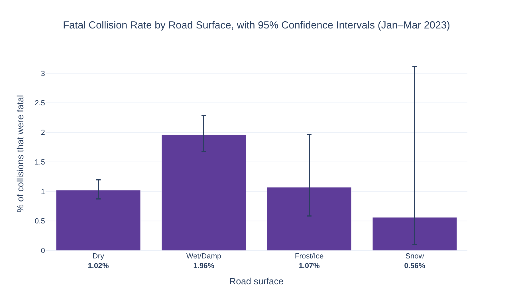
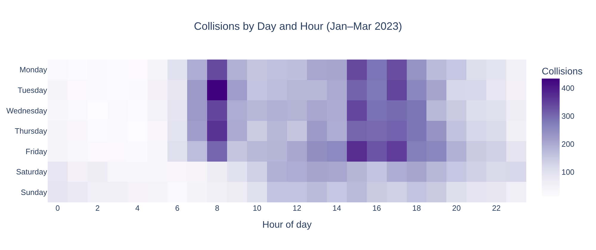

# Winter Road Safety in Great Britain: What Makes an Accident Severe?

An analysis of all 24,495 police-reported road collisions in Great Britain from January to March 2023, looking at how weather, road surface, location and timing relate to collision severity. Built in Python (pandas, SciPy, Plotly, Folium). The project was originally developed during my MSc in Computer Science with Data Science at the University of Sunderland.

## Key findings

**1. Wet roads matter more than bad weather.** Collisions on wet or damp roads were almost twice as likely to be fatal as those on dry roads: 1.96% vs 1.02% (Fisher's exact test p < 0.001, non-overlapping 95% confidence intervals).



**2. Weather on its own tells us little.** Rain without high winds had the same severity profile as fine weather, with about 22% of collisions serious or fatal in both. Weather was not significantly associated with severity (χ² p ≈ 0.08).

**3. Ice and snow were not linked to more severe collisions.** One plausible reason is that drivers slow down when the danger is visible, while wet roads don't feel as dangerous.

**4. The most severe collisions are often rural and single-vehicle.** Rural collisions had almost three times the fatal rate of urban ones (2.35% vs 0.82%), and 48% of fatal collisions involved only one vehicle, compared with 29% of slight ones.

**5. Timing follows travel patterns.** Collisions peaked at 3pm (the school run), 5pm and 8am, and Friday was the busiest day.



**What this could mean for road safety teams:** wet-weather measures on high-risk routes, such as skid-resistant surfacing, drainage and variable speed limits, are likely to do more than general "bad weather" campaigns. Severity-reduction work should focus on rural roads and single-vehicle loss-of-control collisions.

## Methods

1. **Cleaning and quality checks:** parsed dates day-first (DD/MM/YYYY) with a check that none failed, filtered to January–March, mapped DfT codes to readable labels, and checked for duplicates and missing or uninformative values.
2. **Rates, not counts:** fine weather and dry roads are far more common than other conditions, so raw counts mainly reflect how often a condition occurs. Severity is compared using rates (the % of collisions that were serious or fatal, and the % that were fatal), with 95% Wilson confidence intervals.
3. **Statistical testing:** chi-squared tests of independence (slight vs serious or fatal) for weather and road surface, with Cramér's V for effect size and standardised residuals to show where an association comes from. Fisher's exact test was used for fatal collisions on wet vs dry roads.
4. **Visualisation:** Plotly charts (saved as static images so they display on GitHub) and an interactive Folium map.

## Interactive map

`accident_map.html` shows a heatmap of all geolocated collisions, with a marker for each of the 320 fatal collisions. Click a marker to see its date, road surface and weather. GitHub can't display it, so download the file and open it in any browser.

## Repository structure

```
├── uk_road_safety_winter_2023.ipynb   # full analysis
├── accident_map.html                  # interactive map
├── data/
│   ├── dft-road-casualty-statistics-collision-2023.csv   # raw DfT data, all of 2023
│   └── winter_data.csv                                   # Jan–Mar 2023 with readable labels
└── images/                            # all charts, exported by the notebook
```

## How to run

```bash
pip install pandas numpy scipy plotly kaleido folium jupyter
jupyter notebook uk_road_safety_winter_2023.ipynb
```

Charts render as static images. For interactive charts, change `pio.renderers.default = "png"` in the first code cell to `"notebook"` (Jupyter) or `"colab"` (Google Colab).

## Limitations

* **Associations, not causes.** For example, wet roads may coincide with darkness or higher speeds on certain roads.
* **No traffic-volume data.** The analysis shows which collisions are *more severe*, not which conditions produce *more collisions per mile driven*.
* **One winter only, and police-reported collisions only.** Many slight collisions are never reported to the police.

A natural next step is a logistic regression combining road surface, weather, light conditions, speed limit and urban/rural area, to separate their effects.

## Data

[Department for Transport, Road Safety Data 2023](https://www.data.gov.uk/dataset/cb7ae6f0-4be6-4935-9277-47e5ce24a11f/road-safety-data), published under the Open Government Licence.

## Revision note

The first version of this project (April 2025) parsed dates month-first. This silently dropped every collision after the 12th of each month, leaving 9,989 of the 24,495 records. In November 2026 I rebuilt the analysis from scratch on the full dataset. I also added severity rates, confidence intervals and effect sizes, and recreated the original R (ggplot2) charts in Python.

## Author

**Carolina Donato** · [LinkedIn](https://www.linkedin.com/in/carolina-donato/) · [GitHub](https://github.com/CarolinaVDonato)
